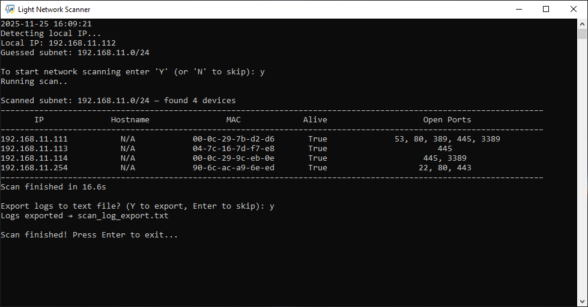

# 🌐 Легкий Сетевой Сканер

Легковесный сканер локальной сети с открытым исходным кодом на Python.
Профессиональный инструмент для **обнаружения устройств**, **диагностики сети** и **административного аудита**.

Быстрое и точное сканирование вашей IPv4 сети без установки дополнительных зависимостей.
Идеально подходит для системных администраторов, специалистов по безопасности и сетевых инженеров.

---

## ⚖️ Законное Использование

**ВНИМАНИЕ:** Данный инструмент предназначен исключительно для законного и авторизованного использования.

- ✅ Необходимо **явное разрешение** владельца сети перед сканированием
- ⚠️ Автор **не несет ответственности** за неправомерное использование
- 📜 Используйте в соответствии с **местным законодательством** и корпоративными политиками
- 🛡️ Создан для **безопасности и администрирования**, а не для атак

**Используйте ответственно и только в законных целях!**

---

## ✨ Основные Возможности

### 🖧 Автоматическое Обнаружение Подсети
- Автоматически определяет вашу IPv4 подсеть
- Интеллектуальное сканирование локальной сети
- Не требует ручной настройки параметров сети

### ⚡ Быстрое и Точное Сканирование
- Комбинирует **ICMP**, **ARP** и **socket** проверки
- Многопоточное сканирование для максимальной скорости
- Минимизация ложных срабатываний

### 🔎 Детекция Открытых Портов
Сканирует наиболее распространенные сервисные порты:
- **FTP** (21) — файловый сервер
- **SSH** (22) — защищенный удаленный доступ
- **Telnet** (23) — терминальный доступ
- **HTTP** (80) — веб-сервер
- **HTTPS** (443) — защищенный веб-сервер
- **SMB** (445) — сетевые папки Windows
- **RDP** (3389) — удаленный рабочий стол
- И другие популярные сервисы

### 🧩 Чистый Консольный Интерфейс
- Стильный черный консольный вывод
- Удобное форматирование результатов
- Консоль остается открытой после завершения сканирования
- Цветная индикация статусов (если поддерживается)

### 🧾 Продвинутая Система Логирования **(NEW!)**
- Автоматическое создание детальных лог-файлов
- Экспорт результатов в текстовый формат
- Сохранение истории всех сканирований
- Подробная информация для последующего анализа

---

## 🚀 Установка и Запуск

### 📋 Системные Требования

- **Python 3.0** или выше
- Поддерживаемые ОС: **Windows**, **Linux**, **macOS**
- **Не требует** установки внешних библиотек! ✨
- Использует только встроенные модули Python

### ▶️ Запуск Сканера

**Windows:**
```bash
python light-net-scanner.py
```

**Linux / macOS:**
```bash
chmod +x light-net-scanner.py
./light-net-scanner.py
```

**Для расширенных прав (рекомендуется):**
```bash
sudo python3 light-net-scanner.py
```

---

## 💡 Сценарии Использования

- 🏠 **Домашняя сеть** — контроль подключенных устройств
- 🏢 **Корпоративный аудит** — инвентаризация сетевого оборудования
- 🔧 **Диагностика** — выявление проблем с подключением
- 🛡️ **Безопасность** — обнаружение неавторизованных устройств
- 📊 **Документирование** — создание карты сети
- 🎓 **Обучение** — изучение сетевых протоколов

---

## 🖼️ Скриншот Работы



---

## 🎯 Особенности

- ✅ **Без зависимостей** — работает сразу после скачивания
- ⚡ **Высокая скорость** — оптимизированные алгоритмы сканирования
- 🔒 **Безопасность** — пассивное сканирование без вреда для сети
- 📈 **Масштабируемость** — работает с сетями любого размера
- 🌍 **Кроссплатформенность** — одинаково работает на всех ОС
- 📝 **Открытый код** — полная прозрачность работы инструмента

---

Автор: legenda  
Telegram: [@LEGENDA_SD](https://t.me/LEGENDA_SD)
